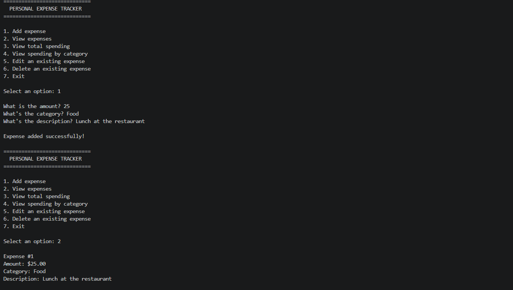

# Python Expense Tracker

A simple command-line expense tracker that I built using Python as one of my personal learning projects.

I'm currently improving my Python skills and I wanted to build something practical where I could apply the concepts I've been studying instead of only solving exercises.

## Features

- Add new expenses
- View all recorded expenses
- Calculate total spending
- View spending by category
- Edit existing expenses
- Delete existing expenses
- Save expense records locally using JSON

## Technologies Used

- Python 3
- JSON
- Python standard library

## How to Run

1. Make sure Python 3 is installed.
2. Download or clone the repository.
3. Open the project folder in your terminal.
4. Run the following command:

   python main.py

## What I Practiced

This project helped me practice:

- Functions and loops
- Conditional statements
- Lists and dictionaries
- Exception handling
- Reading and writing files
- Working with JSON data

## Data Storage

Expenses are saved locally in a file called `expenses.json` inside the project folder.

Each local copy of the application has its own expense data.

## Screenshot

## About the Project

This is an ongoing learning project. I built it to improve my Python programming skills and get more comfortable working on a complete application.

There are still things I can improve and I plan to keep learning and adding improvements as I work on future projects.